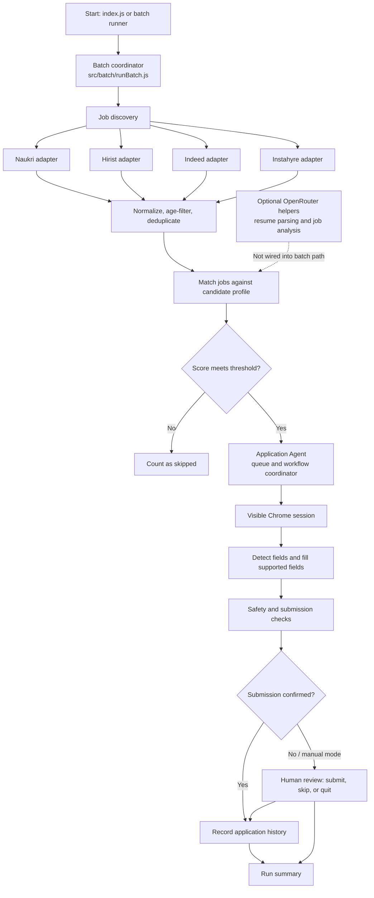

# Job Application Agent

A Node.js command-line agent that finds recent job listings, ranks them against a candidate profile, and assists with applications in a visible Chrome session. The current batch flow supports Naukri, Hirist.tech, Indeed India, and Instahyre. Application forms are detected and safe fields can be filled automatically; submission behavior is controlled by configuration, with a safety scan and a human review path when submission is not confirmed.

## High-level design



### Main components

| Area | Responsibility | Key files |
| --- | --- | --- |
| Entry points | Load environment and start an immediate batch, or run it from the scheduler | `index.js`, `src/batch/runBatch.js`, `src/scheduler/scheduler.js` |
| Discovery | Enable platform adapters, open the discovery browser, and combine unique listings | `src/jobs/discovery/jobDiscovery.js`, `src/jobs/discovery/sources/` |
| Job model and storage helpers | Standardize job records, normalize dates, and remove duplicate listings | `src/jobs/job.js`, `src/jobs/normalizeJobDate.js`, `src/jobs/storage/` |
| Matching | Score job skills, experience, location, and title against the candidate profile | `src/matching/jobMatcher.js`, `src/config/candidateProfile.js` |
| Application workflow | Queue matched jobs, open them by platform, fill forms, handle review decisions, and summarize results | `src/applications/applicationAgent.js`, `src/applications/applicationSession.js`, `src/applications/applicationQueue.js` |
| Browser automation | Configure the persistent Chrome profile and detect/fill application form fields | `src/browser/` |
| Safety | Check form fields for CAPTCHA, sensitive data, and suspicious instructions before automated submission | `src/safety/` |
| History and reporting | Persist confirmed applications and provide history/reporting helpers | `src/applications/applicationHistory.js`, `src/applications/dailyReport.js` |
| Optional analysis | Extract resume text and use OpenRouter-backed parsing/analysis helpers | `src/profile/`, `src/analyzer/` |

The usual batch path is `index.js` → `src/batch/runBatch.js` → discovery → matching → `ApplicationAgent`. The **Application Agent** (`src/applications/applicationAgent.js`) coordinates the application stage: it queues eligible jobs, drives the browser session, tracks each job's state, asks for a human decision when needed, records confirmed applications, and prints the run summary. It currently uses deterministic matching and browser automation; it does not call an LLM to make application decisions. Discovery opens a browser, searches enabled sources, filters listings to the configured age window, deduplicates them, and closes that browser. The application agent then starts its own browser session and assigns tabs by job source. A job must meet the configured match threshold to enter the application queue.

OpenRouter-backed resume parsing and job-description analysis helpers exist under `src/profile/` and `src/analyzer/`, but they are optional utilities and are not connected to the current `index.js` batch flow. In particular, job-description analysis does not currently enrich discovered listings before matching.

The matcher weights skill overlap at 50%, experience at 20%, location at 15%, and role title at 15%. Listings currently arrive with empty skill arrays from the platform adapters, so the skill portion can score as a full match until job-description skill extraction is connected to this path. The run's effective queue threshold is `matching.threshold` in `src/config/agentConfig.js`.

## Setup

Requirements: Node.js, npm, and installed Google Chrome. Install dependencies and configure the environment:

```sh
npm install
cp .env.example .env
```

Edit `.env` with candidate details and any platform credentials you use. Keep `.env` private. Candidate skills, target roles, preferred locations, and work preferences live in `src/config/candidate.json`; personal details and experience overrides are read from environment variables by `src/config/candidateProfile.js`.

The browser runs visibly using Chrome. By default it keeps a separate profile in `data/browser-profile`. To use an existing Chrome login, set `BROWSER_USER_DATA_DIR` in `.env` to that profile's directory and close all Chrome windows before starting the agent. Set `BROWSER_CHANNEL` if Chrome is installed under a different Playwright channel name.

## Running

Start a one-off discovery and application batch:

```sh
npm start
```

This invokes `nodemon index.js`. To invoke the batch runner directly without nodemon:

```sh
node src/batch/runBatch.js
```

The scheduler entry point is `node src/scheduler/scheduler.js`; it checks the configured local time every minute and starts a batch at the configured hour and minute. `npm start` does not start the scheduler.

## Configuration

| Setting | Location | Purpose |
| --- | --- | --- |
| `ENABLE_NAUKRI`, `ENABLE_HIRIST`, `ENABLE_INDEED`, `ENABLE_INSTAHYRE` | `.env` | Enable or disable each discovery source; all default to enabled. Set a flag to `false` to skip that source. |
| `ENABLE_OLDER_JOBS` | `.env` | Set `true` to include all detected listings older than the configured 24-hour window (and process them through normal matching); defaults to `false`, which hides known-old listings. |
| `NAUKRI_EMAIL`, `NAUKRI_PASSWORD` | `.env` | Naukri sign-in credentials. Hirist discovery uses public listings; sign in to Hirist in the configured Chrome profile if an application requires it. |
| `INSTAHYRE_MATCH_THRESHOLD` | `.env` | Instahyre's visible InstaMatch score must be strictly greater than this value before the agent opens the Apply action; defaults to `70` and accepts values from 0 to 100. Jobs with a missing or unreadable score are skipped. |
| `CANDIDATE_*` | `.env` | Candidate identity, location, experience, and notice-period values. |
| `BROWSER_CHANNEL`, `BROWSER_USER_DATA_DIR` | `.env` | Chrome channel and optional existing user profile path. |
| Match threshold and scheduler time | `src/config/agentConfig.js` | Matching cutoff and daily scheduler time. |
| Job age window and submission options | `src/config/application.json` | Recent-listing window and application submission settings. |
| Skills, target roles, preferred locations | `src/config/candidate.json` | Reusable candidate matching profile. |

The platform registry and search options are currently defined in `src/jobs/discovery/jobDiscovery.js`. Add new sources there and provide a discovery adapter that returns the shared job shape from `src/jobs/job.js`.

## Application review and safety

The application agent detects forms and fills supported fields. `src/config/application.json` currently enables `autoSubmit`; when enabled, submission is attempted only if the safety scan passes, required fields are valid, and a clear submit control is found. The agent records an application automatically only when the page presents recognized confirmation text. If submission is disabled or cannot be confirmed, the agent asks for a human decision in the terminal: `S` to mark as submitted, `K` to skip, or `Q` to stop the batch. Review the page and any populated answers before confirming.

Form scanning is implemented in `src/safety/safetyScanner.js` and the corresponding rules in `src/safety/safetyRules.js`. It blocks automatic submission when it detects CAPTCHA, sensitive fields, or suspicious instructions. This is a guardrail, not a guarantee that every site or form can be handled safely; keep the browser visible and review each application.

## Data and privacy

- `.env` contains personal details, credentials, and the OpenRouter API key; do not commit or share it.
- `src/documents/resume.pdf` is the default resume input for the optional resume parser. Resume text is sent to OpenRouter when that parser is run.
- `src/data/` contains application-related JSON data. `src/applications/applicationHistory.js` writes confirmed application records to `src/data/applicationHistory.json`.
- The persistent Chrome profile may contain authenticated sessions and other browser data.

## Project layout

```text
src/
  analyzer/       Optional job-description analysis
  applications/   Queue, browser workflow, history, and reports
  batch/          Main discover → match → apply orchestration
  browser/        Playwright/Chrome setup and form helpers
  config/         Candidate and agent configuration
  data/           JSON application data and history
  documents/      Resume input
  jobs/           Job model, platform adapters, normalization, storage
  matching/       Candidate-to-job scoring
  profile/        Resume text extraction and parsing
  safety/         Form safety rules and scanner
  scheduler/      Optional time-based batch runner
```
